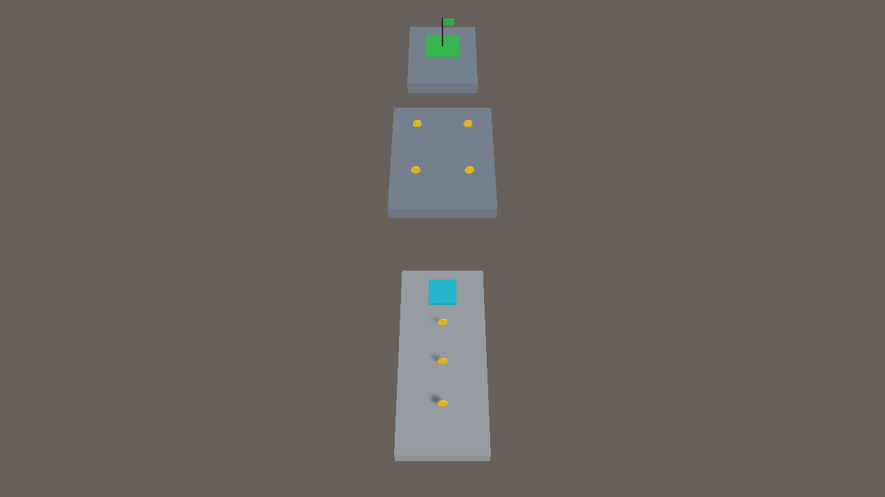
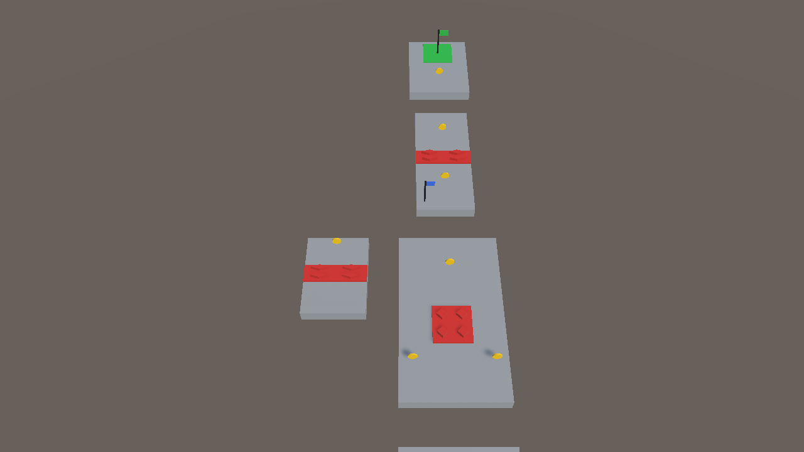
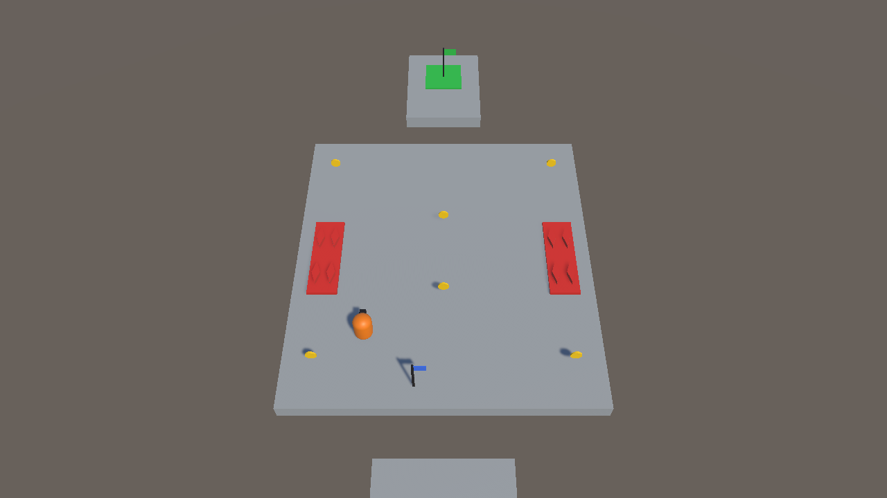
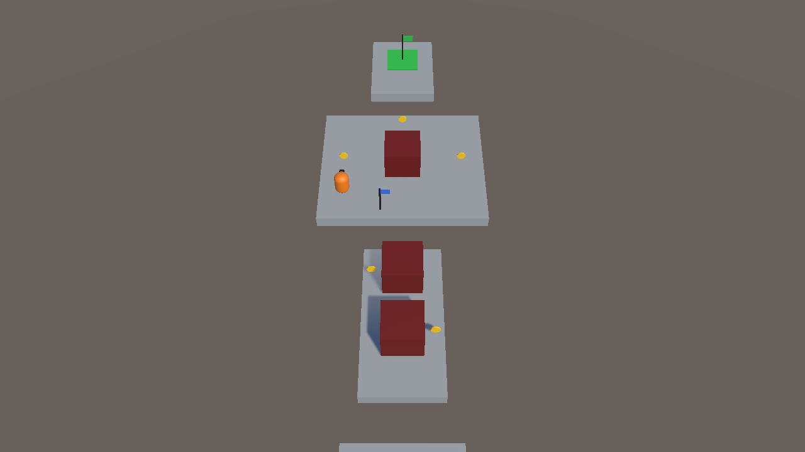
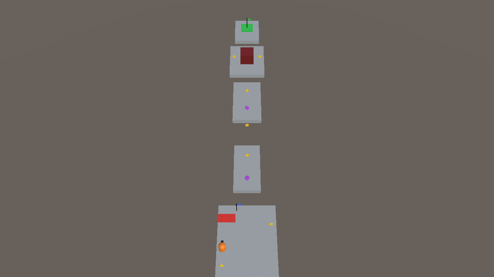

# CS464 Assignment 03 · Muhammad Sarmad Ahmad · BSSE23013

- **Video (60–120 s):** https://drive.google.com/file/d/1EQiRTkltev9-jd5DK6LRbSLtIDOberRF/view?usp=sharing
- **Started from:** New project (Instructions given by sir)
- **Controls:** WASD or the arrow keys to move, Space to jump
- **To win a level:** collect the coins the HUD asks for (6 to 9 depending on the level), then step on the green goal. Reaching the goal early only shows a hint.

## Levels

| Level | Screenshot | New idea | Combined with |
|---|---|---|---|
| Level01 |  | Coins, a goal and the bounce pad (a VelocityChange kick up to a high platform) | Nothing hurts yet, so it is safe to try |
| Level02 |  | Spikes, and hearts that go one at a time | A coin on a detour behind its own spike strip |
| Level03 |  | A guard that patrols, chases and walks back | Spikes on both sides of its route, and a checkpoint |
| Level04 |  | The crusher: rest, a warning, then the strike (2 hearts) | A guard patrolling right beside a third crusher |
| Level05 |  | Two speed pickups, needed for a 6.5 m gap | A ping-pong guard, spikes, a checkpoint and a crusher |

## The numbers

| Number | Value | Why this value |
|---|---|---|
| Patrol speed | 2 m/s | My run speed is 5 m/s, so a patrolling guard is easy to read and to pass. |
| Chase speed | 3.5 m/s | Still slower than I run (5 m/s), so I can always get away on open ground. |
| Chase range | 6 m (gives up at 10 m) | A guard on its route sees me when I step onto its platform but not from the next one. The longer give-up range stops it flickering between chase and return at one edge. |
| Knockback | 8, ForceMode.Impulse, no steering for 0.3 s | The mass is 1, so it is an 8 m/s kick for about 0.3 s, roughly 2.4 m. That is enough to clear a 1.5 m spike strip or a 3 m crusher edge. |
| I-frames | 1 s | After the push I am clear of the hazard in about 0.3 s, and the rest is time to run away before the next hit can land. |
| Power-up duration | 5 s (×1.6, so 8 m/s) | Long enough to run from the pickup, cross the 6.5 m gap (an 8 m/s jump reaches about 8 m) and reach the second pickup; not long enough to carry through the crusher yard. |
| Crusher warning | 0.8 s | Over the 0.5 s minimum, and enough to see the red floor and step out. |
| Respawn protection | 1.5 s | A beat longer than the i-frames, so I never respawn into a hit. |

## Short answers

**1. Why does a trigger need a Rigidbody on at least one of the two objects?**

Unity only reports contact events for pairs where something is a Rigidbody; two colliders that are both static are left out of the physics event pass, so nothing fires and nothing says why. In my levels the player has the Rigidbody, so the coins, spikes, checkpoints and goal (which have only a trigger collider) all work. The guard has its own kinematic Rigidbody because a script moves it.

**2. Which ForceMode do your knockback and your Part A force use, and why each?**

The knockback uses Impulse: one kick, divided by mass, applied once when the hit lands (`Knockback()` on the controller also stops steering for 0.3 s, otherwise my move line would wipe it a step later). The bounce pad uses VelocityChange: one kick that ignores mass, straight up at 10 m/s from `OnTriggerEnter`, so it lifts me the same height every time (about 5 m).

**3. What does your code do when a second power-up is picked up while one is running?**

It refreshes. `BoostSpeed` stops the running coroutine and starts a new one, so the 5 s timer restarts and the multiplier stays at 1.6 (it does not stack). Two pickups 3 s apart end at 8 s. The timer runs on the player, so it keeps going after the pickup hides itself.

**4. Why can `==` fail as an arrival check, and when does it work?**

`==` on two Vector3 values only works if every component is exactly equal, and a moving guard, a chase target or a path that changes direction almost never lands on the exact same float values. It works right after `MoveTowards`, because `MoveTowards` returns exactly the target once it is within one step. My guard checks `Vector3.Distance(...) < arriveDistance` (0.1 m) instead, which also works after chasing and returning.
